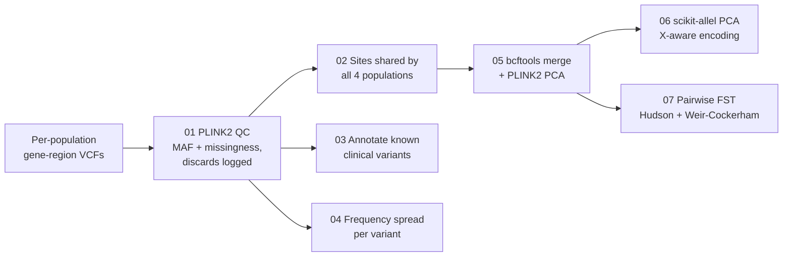

# Subpopulation Allele Frequency Divergence in South Asia

[](https://github.com/shivika2202/south-asian-allele-divergence/actions/workflows/tests.yml)   

A reproducible population genetics pipeline that tests whether the single "South Asian" ancestry label hides clinically relevant genetic differences between subpopulations. It compares four South Asian populations from the 1000 Genomes Project across three genes that matter for drug response and inherited blood disorders.

Built by **Shivika Gupta** (University of Pennsylvania, Vagelos Program in Life Sciences & Management) as summer research in 2026, with support from LifeCell.

---

## The question

Genetic reference data usually pools India, Pakistan, Bangladesh and the rest of the region under one "South Asian" label. Clinical decisions then rely on those pooled allele frequencies: who is likely to be a poor metabolizer of clopidogrel, or who should be screened for G6PD deficiency before taking primaquine. If subpopulations differ, the pooled number can be wrong for real patients.

This project asks, gene by gene: **do these subpopulations actually differ, and do different methods agree on the answer?**

## Data

[1000 Genomes Project Phase 3](https://www.internationalgenome.org/) (open access, GRCh37), 387 individuals:

| Code | Population | Samples |
|---|---|---|
| GIH | Gujarati Indians in Houston, Texas | 103 |
| PJL | Punjabis in Lahore, Pakistan | 96 |
| BEB | Bengalis in Bangladesh | 86 |
| ITU | Indian Telugus in the UK | 102 |

| Gene | Location | Clinical relevance |
|---|---|---|
| CYP2C19 | chr10 | Activates the antiplatelet drug clopidogrel; *2/*3 cause poor metabolism, *17 rapid metabolism |
| HBB | chr11 | Beta-globin; variants cause beta-thalassemia, common across South Asia |
| G6PD | chrX | Enzyme deficiency causing drug- and infection-triggered hemolysis; X-linked |

## Pipeline



| Step | Script | What it does |
|---|---|---|
| 1 | [`01_plink_qc.sh`](scripts/01_plink_qc.sh) | Filters each gene x population at MAF 0.05 and 5% missingness with PLINK2, and records every discarded variant |
| 2 | [`02_find_shared_variants.py`](scripts/02_find_shared_variants.py) | Keeps sites that pass QC in all four populations; checks no sample is assigned to two populations |
| 3 | [`03_annotate_variants.py`](scripts/03_annotate_variants.py) | Labels known clinical variants (rsID, star allele) from a curated [lookup table](data/variant_reference_lookup.csv); reads both PLINK2 and vcftools output |
| 4 | [`04_freq_comparison.py`](scripts/04_freq_comparison.py) | Ranks variants by cross-population allele frequency spread (max minus min) |
| 5 | [`05_merge_and_pca_plink.sh`](scripts/05_merge_and_pca_plink.sh) | Merges populations on the shared sites; PLINK2 PCA, unpruned and LD-pruned |
| 6 | [`06_pca_scikit_allel.py`](scripts/06_pca_scikit_allel.py) | PCA for all three genes with sex-aware encoding of chrX genotypes |
| 7 | [`07_fst.sh`](scripts/07_fst.sh) | Pairwise FST between all six population pairs, two estimators |
| | [`plots/`](scripts/plots/) | PCA, scree and frequency-spread figures (R, ggplot2) |

## Design decisions

- **Population-level and individual-level methods side by side.** FST measures differentiation per locus across a whole population; PCA looks for structure among individuals. Running both shows when they disagree, and disagreement turned out to be one of the main results.
- **Correct handling of the X chromosome.** Males carry one copy of chrX, but genotype arrays pad the missing second copy with the same value used for missing data. Step 6 uses each sample's recorded sex to encode male calls on the same 0/1/2 scale as diploid calls, instead of silently treating every male genotype as missing. PLINK2's PCA excludes chrX entirely, which is why this step exists.
- **Merging on shared sites only.** Each population was filtered separately, so their variant sets differ slightly. Restricting the merge to sites that pass in all four avoids creating missing data that would look like population differences.
- **The right merge tool.** bcftools merge combines different samples at the same sites; PLINK2's merge is built for the opposite case.
- **Transparent QC.** A standard MAF filter can remove clinically important low-frequency alleles, so step 1 writes out exactly which variants each filter removed, per gene and population.
- **Cross-checked estimators.** Hudson FST is the primary estimate (less biased for small, unequal panels); Weir-Cockerham is run alongside as a check where PLINK2 supports it.

## Findings (summary)

Allele frequency differences alone were not a reliable sign of real population structure: two genes showed measurable frequency spreads without detectable differentiation, while one gene showed a single subpopulation diverging from the other three. In that case FST detected the divergence and PCA did not, so relying on PCA alone would have missed it. The full analysis is in a manuscript in preparation and is not included here.

## Reproducibility

Running [`run_pipeline.sh`](run_pipeline.sh) from the input VCFs reproduces the original analysis byte for byte: all QC counts, allele frequencies, shared-site lists, frequency comparisons, FST summaries and PCA outputs.

Tested with PLINK v2.00a5.12, bcftools 1.24, Python 3.12 (versions pinned in [`requirements.txt`](requirements.txt)) and R with ggplot2, dplyr, readr, tidyr and stringr.

```bash
python3 -m venv .venv && .venv/bin/pip install -r requirements-dev.txt
PYTHON=.venv/bin/python bash run_pipeline.sh --plots    # needs the input VCFs in data/vcf/
.venv/bin/python -m pytest -q                          # offline unit tests, also run on every push
```

## Input data

The pipeline starts from 12 per-population VCFs in `data/vcf/` (`CYP2C19_GIH.vcf.gz`, `CYP2C19_PJL.vcf.gz`, ..., `G6PD_ITU.vcf.gz`). They are not committed, but these commands rebuild them from the public 1000 Genomes Phase 3 release on its AWS S3 mirror. bcftools streams only the needed regions, so nothing large is downloaded. Rebuilt this way, all 12 files match the originals record for record.

Run from `data/vcf/`:

```bash
BASE=https://1000genomes.s3.amazonaws.com/release/20130502

# 1. Extract each gene region (GRCh37, 5 kb flank on each side)
bcftools view -r 10:96517438-96620304 \
  $BASE/ALL.chr10.phase3_shapeit2_mvncall_integrated_v5a.20130502.genotypes.vcf.gz -Oz -o CYP2C19_region.vcf.gz
bcftools view -r 11:5241694-5253301 \
  $BASE/ALL.chr11.phase3_shapeit2_mvncall_integrated_v5a.20130502.genotypes.vcf.gz -Oz -o HBB_region.vcf.gz
bcftools view -r X:153754605-153780784 \
  $BASE/ALL.chrX.phase3_shapeit2_mvncall_integrated_v1b.20130502.genotypes.vcf.gz -Oz -o G6PD_region.vcf.gz

# 2. Split each region by population and index
for GENE in CYP2C19 HBB G6PD; do
  for POP in GIH PJL BEB ITU; do
    bcftools view -S ../panel/${POP}_samples.txt ${GENE}_region.vcf.gz -Oz -o ${GENE}_${POP}.vcf.gz
    tabix -p vcf ${GENE}_${POP}.vcf.gz
  done
done
```

Sample lists and [`data/sex_info.txt`](data/sex_info.txt) come from the 1000 Genomes Phase 3 sample panel.

## Layout

```
run_pipeline.sh              runs steps 1-7 (and plots) in order
scripts/                     one script per step, numbered
scripts/plots/               R figures
data/panel/                  sample IDs per population (1000 Genomes)
data/sex_info.txt            sample sex, used for chrX handling
data/variant_reference_lookup.csv   curated clinical variants (ClinVar, PharmGKB, HbVar, OMIM)
data/vcf/                    inputs and outputs (not committed)
tests/                       unit tests for the parsing, frequency and encoding logic
```

## Data source

The 1000 Genomes Project Consortium. A global reference for human genetic variation. *Nature* 526, 68-74 (2015).

## License

Code: [MIT](LICENSE). 1000 Genomes data is open access under the project's data reuse policy.
